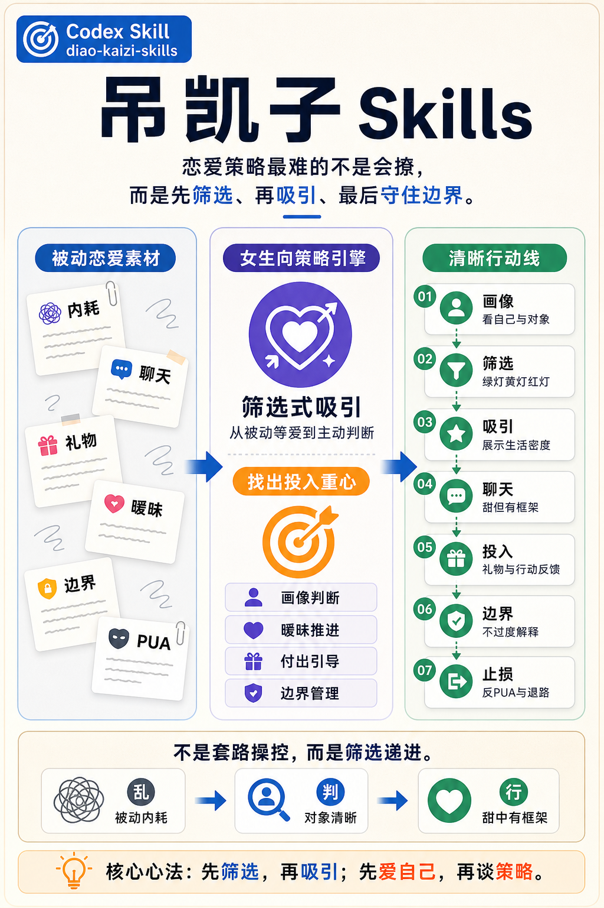

# 吊凯子 Skills



女生向恋爱筛选、吸引、暧昧推进、付出引导和边界管理 Codex Skill。它把“被动等爱、内耗、不会开口、被白嫖”的散乱恋爱素材，整理成“先筛选、再吸引、会表达需求、能收回投入、保留退路”的可执行策略引擎。

资料贡献特别鸣谢群友：毛总（神颜+AIGC公主+PUA女皇+金融掌控者+不屑男人+吊凯子女王）。

## 适用场景

- 帮女生分析男生画像、关系阶段和投入价值。
- 设计认识优质男、筛选对象、第一次聊天和暧昧推进路径。
- 生成微信、社交软件、约会前后、吵架修复、要礼物和立框架话术。
- 判断男生的绿灯、黄灯、红灯信号，决定继续、降温或止损。
- 把“推拉、撒娇、情绪价值、礼物付出、反PUA”等材料转成更稳的实战策略。
- 帮用户建立“甜是手段，筛选是底盘，边界是退路”的长期框架。

## 核心取向

本 Skill 的重点不是单纯堆话术，而是按照以下顺序处理恋爱问题：

1. 先看自己：目标、优势、底线、可投入资源。
2. 再看对象：情绪稳定度、责任心、付出意识、三观和风险。
3. 判断阶段：刚认识、暧昧、约会中、已确认关系、冷淡期或止损期。
4. 设计动作：聊天、邀约、升温、要礼物、立框架或退出。
5. 守住边界：不自轻自贱、不强迫对方、不消耗自己。

## 底线

本 Skill 会围绕用户目标给出可执行策略，但不提供以下内容的执行方案：

- 面向未成年人或无法同意者的亲密/性推进。
- 胁迫、灌酒、下药、利用醉酒或意识不清状态。
- 跟踪、骚扰、无视拒绝、纠缠、偷拍或传播隐私。
- 骗婚骗钱、虚构重大事实、用虚假承诺换取资源或亲密关系。
- 利用明显权力差压迫，例如上下级、师生、医患或资源控制关系。
- 报复、羞辱、故意冷暴力、诱导崩溃或造成现实伤害。

遇到原始材料里的“冷暴力、洗脑、服从、操控”等表达，本 Skill 会保留可用的人性洞察，并转译成“行为反馈、明确边界、正向强化、暂停投入、及时止损”。

## 工作方式

Skill 会优先确认三件事：

1. 用户是谁：年龄、城市、职业/生活状态、恋爱经验、当前目标、投入精力和底线。
2. 对象是谁：年龄、职业/生活状态、关系状态、认识渠道、互动记录和风险信号。
3. 任务是什么：聊天回复、开场、升温、约会、要礼物、立规矩、判断值不值得、反PUA或止损。

输出通常包含：

```text
目标：
判断：
策略：
话术：
风险：
追问：
```

聊天回复会输出：

```text
他这句话的可能含义：
不要这样回：
推荐回复：
更甜一点：
更有框架一点：
下一步观察：
```

## 文件结构

```text
diao-kaizi-skills/
├── SKILL.md
├── README.md
├── agents/
│   └── openai.yaml
├── assets/
│   └── cover.png
└── references/
    ├── anti-pua-and-self-work.md
    ├── boundaries-and-framing.md
    ├── chat-flirting-playbook.md
    ├── gifts-and-investment.md
    ├── intake-and-framework.md
    └── screening-and-acquisition.md
```

## 安装

复制或克隆本目录到 Codex skills 目录：

```bash
mkdir -p ~/.codex/skills
cp -R diao-kaizi-skills ~/.codex/skills/
```

在 Codex 中可通过以下方式显式触发：

```text
$diao-kaizi-skills
```

示例：

```text
$diao-kaizi-skills 帮我分析这个男生值不值得继续聊，下一句怎么回更甜但有框架？
```

## 资料整理说明

本 Skill 基于本地“点点（提升认知，恋商+情商）”相关 PDF 材料整理，并参考 `guanxi-gonglueshi` 的 Skill 结构进行拆分。整理方式不是照搬原文话术库，而是抽取其中可复用的关系判断、沟通结构和阶段策略，再按安全边界重新组织。

## 设计来源

该 Skill 面向女生视角：先筛选对象，再建设吸引；先爱自己，再谈策略；嘴上可以甜，行为必须有框架。
